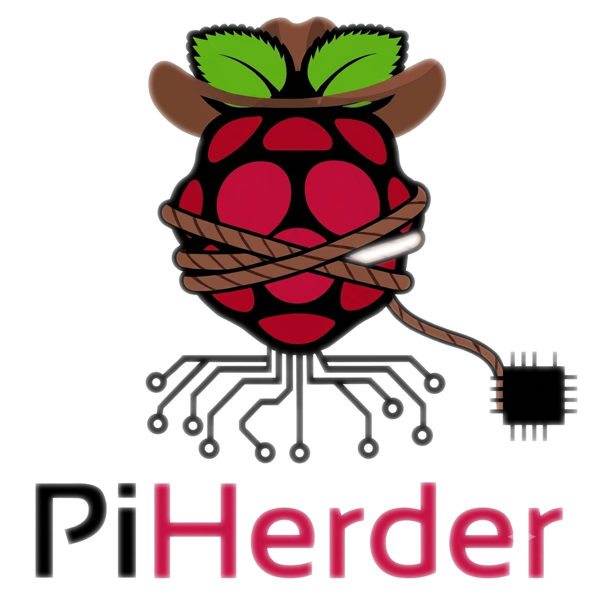

# PiHerder

**Self-hosted control plane for the Pis and Linux boxes you already SSH into — backups, patching, Compose, and an audit trail. Secrets in the database are encrypted; the master key stays on your disk.**

### Why PiHerder?

After 30+ years as an engineer, senior cybersecurity leader, tinkerer, hacker, and 3D designer/builder, I got tired of brittle bash scripts and manual processes across my Raspberry Pi clusters and homelab.

PiHerder was born the same way many great tools are: **scripts that automate the boring stuff so I could focus on building and securing systems**. It replaces manual workflows with an auditable web UI. Fleet secrets in the database are Fernet-encrypted; `PIHERDER_MASTER_KEY` stays in your host `.env`.

Inspired by projects like [Nginx Proxy Manager](https://github.com/NginxProxyManager/nginx-proxy-manager) — simple, powerful, self-hosted tools that just make life easier.

### Key Features

- SSH key management with encrypted private keys
- Backups, OS patching (apt), **HAOS** hosts via SSH + `ha` CLI check/apply, container patching with schedules
- Docker Compose browser, multi-file editing, **compose sets** (multiple compose files under one project), inventory cache
- Service templates (deploy wizard, variables, preview/confirm)
- Integrations: Uptime Kuma, Grafana, Pi-hole (v6), Nginx Proxy Manager + cert management
- **LAN Discovery** (opt-in nmap worker, devices, schedules, Hosts map overlay)
- Network Maps (DNS fabric, logical/physical topology, service paths, runtime stack view groups)
- **Reports:** backup dest, OS patches, LAN live, Docker deploys, console sessions (PiHerder history — not Grafana). Pin / hide / reorder cards per browser
- PWA + Web Push notifications
- RBAC, 2FA (TOTP + passkeys), optional SSO/OIDC, audit trail, self-backup with full DR
- Optional in-browser **web SSH console** (off by default). Per host, **Console mux** can attach `tmux` or `screen` so Hide keeps the shell on the Pi
- Optional **Host Files** jailed SFTP explorer (off by default; `PIHERDER_HOST_FILES`)
- **Move a service** — compose project host→host as one job (on by default; set `PIHERDER_SERVICE_MIGRATE=false` to turn it off). Runs on the Celery worker. A failure after names flip can be undone. A finished Move has no Undo
- Token REST API for automation (n8n, Home Assistant, etc.). Home Assistant observes the fleet with HACS [piherder-ha](https://github.com/bjorngluck/piherder-ha) (not inside this image). **v1.8.0** pairs with plugin **0.4.4**. **v1.7.0** pairs with plugin **0.3.0**. Current plugin is **[0.5.4](https://github.com/bjorngluck/piherder-ha/releases/tag/v0.5.4)** (poll-only, card served from `/piherder/` as a Lovelace resource). It pairs with PiHerder **v1.13.0** and needs Home Assistant **2024.7** or newer. A `read` token is sensors and the card. `jobs` and `edit` add confirm actions, including host reboot. Agents use hosted `POST /mcp`, or the air-gapped [piherder-mcp](https://github.com/bjorngluck/piherder-mcp) adapter **[0.4.4](https://github.com/bjorngluck/piherder-mcp/releases/tag/v0.4.4)** (`list_alerts`, `prune_build_cache`, `replace_stale_mac`, `prune_docker`, the backup schedule fields, `start_move`, `read_discovery`, `start_discovery`, and the LAN Discovery device tools). It also lists `fleet_summary`. The **1.13.0** image does not serve `GET /api/v1/fleet/summary`, so that tool returns 404 there. Volume prune stays on the Docker page. **0.4.3** does not list those four. A cached **0.4.3** needs `uvx --refresh piherder-mcp`, then a restart of the MCP client. `list_alerts`, `prune_build_cache`, and `replace_stale_mac` are in the **1.13.0** image.

### Quick Start

See the full **[Getting Started guide](https://piherder-docs.hacknow.info/getting-started/install/)**.

1. Clone this repo or copy `.env.example` → `.env`
2. Generate `PIHERDER_MASTER_KEY` (critical)
3. (Recommended) Set hostname + trusted TLS certs for PWA/push
4. `docker compose up -d` (pulls multi-arch `bjorngluck/piherder:latest`)
5. Register first admin user and start adding servers

### Open Source & Contributing

PiHerder is now **open source** under the MIT license. Contributions, issues, feature ideas, and PRs are very welcome.

See [CONTRIBUTING.md](CONTRIBUTING.md) for details.

If you find PiHerder useful, consider [sponsoring the project](https://github.com/sponsors/bjorngluck) or [buying me a coffee](https://www.buymeacoffee.com/bjorngluck) — it helps fund continued development and infrastructure.

&nbsp;

### Documentation

- Full docs & wiki: [piherder-docs.hacknow.info](https://piherder-docs.hacknow.info/)
- Admin guide: [docs/ADMIN.md](docs/ADMIN.md)
- Ecosystem roadmap: [docs/ROADMAP_ECOSYSTEM.md](docs/ROADMAP_ECOSYSTEM.md)
- **Current release:** [docs/RELEASE_v1.13.0.md](docs/RELEASE_v1.13.0.md). Tag **v1.13.0**. certifi **2026.10.19**. Package **1.13.0**. Image `bjorngluck/piherder:1.13.0` · `1.13` · `latest`. Pin `1.12.1` stays that patch. Pin `1.12.0` stays that patch. Pin `1.11.1` / `1.11` is the previous minor image. Plugin **[0.5.4](https://github.com/bjorngluck/piherder-ha/releases/tag/v0.5.4)**. MCP adapter **[0.4.4](https://github.com/bjorngluck/piherder-mcp/releases/tag/v0.4.4)**. Wiki: [Backups](wiki/day-to-day/backups.md) · [Self-backup](wiki/operations/self-backup.md) · [Agents (MCP)](wiki/operations/mcp.md) · [Home Assistant](wiki/integrations/home-assistant.md).
- **Prior:** [docs/RELEASE_v1.12.1.md](docs/RELEASE_v1.12.1.md) · [docs/RELEASE_v1.12.0.md](docs/RELEASE_v1.12.0.md). [QA](docs/QA_v1.13.0.md) signed 2026-10-25. [QA](docs/QA_v1.12.0.md) signed 2026-10-20.
- **Prior:** [docs/RELEASE_v1.9.0.md](docs/RELEASE_v1.9.0.md) · [docs/RELEASE_v1.8.1.md](docs/RELEASE_v1.8.1.md) · [docs/RELEASE_v1.8.0.md](docs/RELEASE_v1.8.0.md). Sync rule: [docs/RELEASE_SYNC.md](docs/RELEASE_SYNC.md).
- Prior: [docs/RELEASE_v1.5.0.md](docs/RELEASE_v1.5.0.md) · [docs/RELEASE_v1.4.0.md](docs/RELEASE_v1.4.0.md) · [docs/RELEASE_v1.3.0.md](docs/RELEASE_v1.3.0.md) · [docs/RELEASE_v1.2.0.md](docs/RELEASE_v1.2.0.md) · [docs/RELEASE_v1.1.1.md](docs/RELEASE_v1.1.1.md) · [docs/RELEASE_v1.0.0.md](docs/RELEASE_v1.0.0.md) · operator wiki [LAN Discovery](wiki/integrations/lan-discovery.md) · [HAOS hosts](wiki/day-to-day/haos-hosts.md)
- API reference: [docs/API.md](docs/API.md)

### Public demo (view-only)

Explore the UI before installing: **[https://piherder-demo.hacknow.info](https://piherder-demo.hacknow.info)**

Shared **viewer** login — current username and password are on the **[wiki / Public demo](https://piherder-docs.hacknow.info/operations/demo-site/)** page. The fleet is synthetic; there is no path to your machines. Limits and notes live on that wiki page.

### Tech Stack

FastAPI + SQLModel + PostgreSQL + Paramiko + cryptography (Fernet) + Jinja2 + compiled Tailwind + HTMX + Alpine + APScheduler + Celery.

**Offline / air-gapped ready** — Once built, the container has no external CDN dependencies. Tailwind utilities are compiled CSS (no Play / no eval).

### License

MIT — see [LICENSE](LICENSE).

---

**Repository:** [github.com/bjorngluck/piherder](https://github.com/bjorngluck/piherder)
