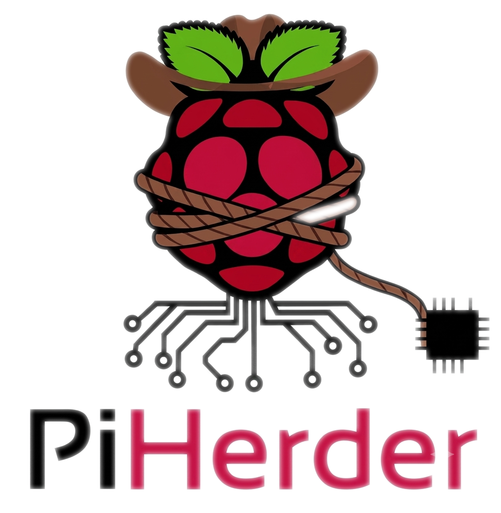

# PiHerder

**Self-hosted control plane for the Pis and Linux boxes you already SSH into. Backups, patching, Compose, and an audit trail. Secrets in the database are encrypted. The master key stays on your disk.**

PiHerder is the web UI that replaced a pile of fleet scripts: backups, patching, Compose, and a log of who did what. Secrets in the database are Fernet-encrypted. `PIHERDER_MASTER_KEY` stays in your host `.env`.

## What you can do

- Add hosts over SSH. Private keys are encrypted at rest.
- Schedule backups, apt updates, and container image checks. An HAOS host uses the `ha` CLI.
- Browse Compose projects, edit a stack, and move a project to another host.
- Discover addresses on the LAN, map DNS and paths, and watch Pi-hole, Nginx Proxy Manager, Grafana, and Uptime Kuma.
- Sign in with a password, TOTP, a passkey, or SSO. Web SSH and the jailed file browser stay off until you turn them on.
- Give Home Assistant or an agent a token. The plugin is a separate HACS install, **[0.5.4](https://github.com/bjorngluck/piherder-ha/releases/tag/v0.5.4)**, and it is not inside this image. The MCP adapter is **[0.4.4](https://github.com/bjorngluck/piherder-mcp/releases/tag/v0.4.4)**. Hosted volume prune is on this herder. Adapter 0.4.4 does not list that tool.

## Install

Full steps: **[Getting started](https://piherder-docs.hacknow.info/getting-started/install/)**.

1. Copy `.env.example` to `.env` and set `PIHERDER_MASTER_KEY`.
2. `docker compose up -d` pulls `bjorngluck/piherder:latest`.
3. Register the first admin and add a server.

Docker Hub `latest` is still **1.14.0**. This branch is package **1.15.0**, frozen on 2026-11-08, and not tagged. Pin `1.13.0` stays that release.

## Docs

- Operator wiki: [piherder-docs.hacknow.info](https://piherder-docs.hacknow.info/)
- This train (draft): [RELEASE_v1.15.0.md](docs/RELEASE_v1.15.0.md) · [PLAN](docs/PLAN_v1.15.0.md) · [QA](docs/QA_v1.15.0.md). Walks are not signed.
- Published release: [v1.14.0](docs/RELEASE_v1.14.0.md). Older notes are listed in [docs/README.md](docs/README.md).
- API: [docs/API.md](docs/API.md) · Admin: [docs/ADMIN.md](docs/ADMIN.md)

## Demo

[piherder-demo.hacknow.info](https://piherder-demo.hacknow.info) is a view-only fleet. The shared login is on the [demo page](https://piherder-docs.hacknow.info/operations/demo-site/).

## Contributing

Issues and pull requests are welcome. See [CONTRIBUTING.md](CONTRIBUTING.md). If PiHerder is useful, you can [sponsor the work](https://github.com/sponsors/bjorngluck).

FastAPI, SQLModel, PostgreSQL, Paramiko, and Celery. The built image does not load a CDN.

MIT. See [LICENSE](LICENSE).
