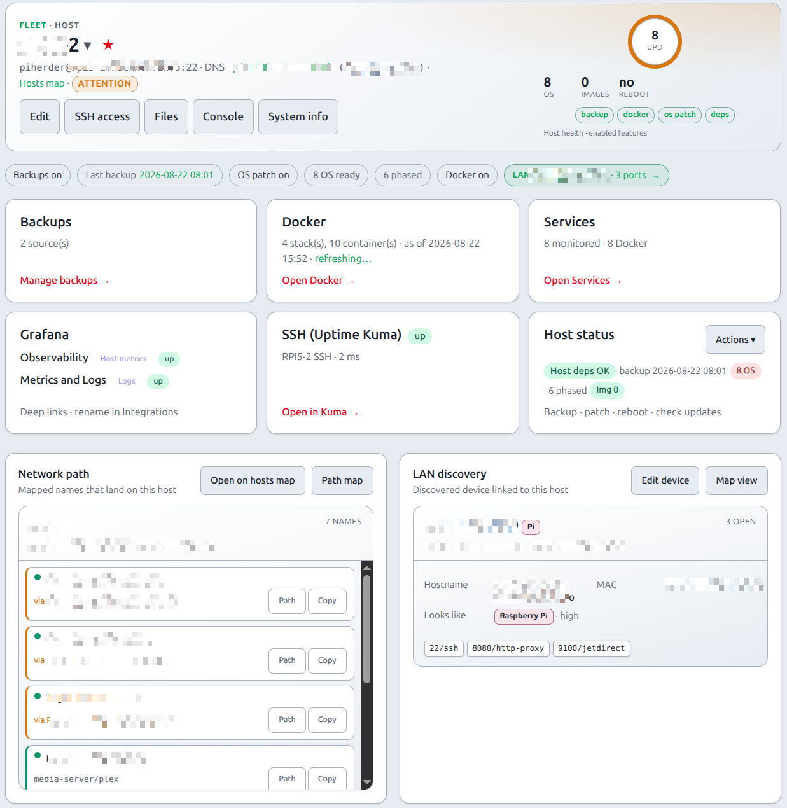
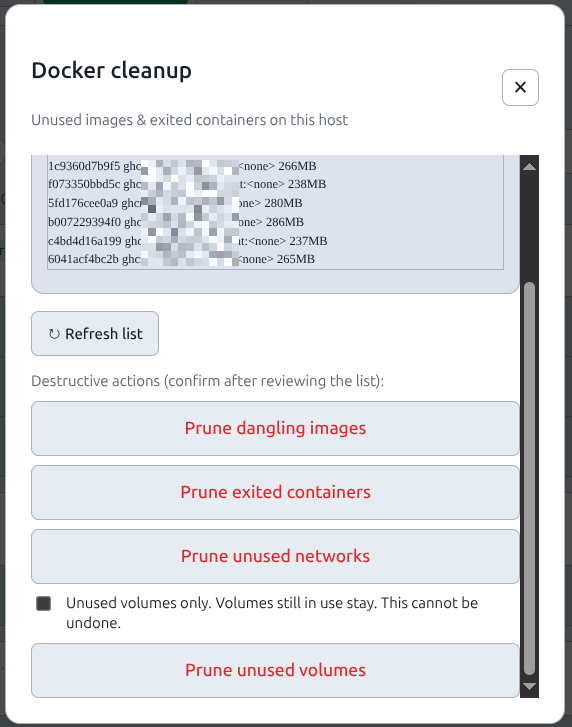
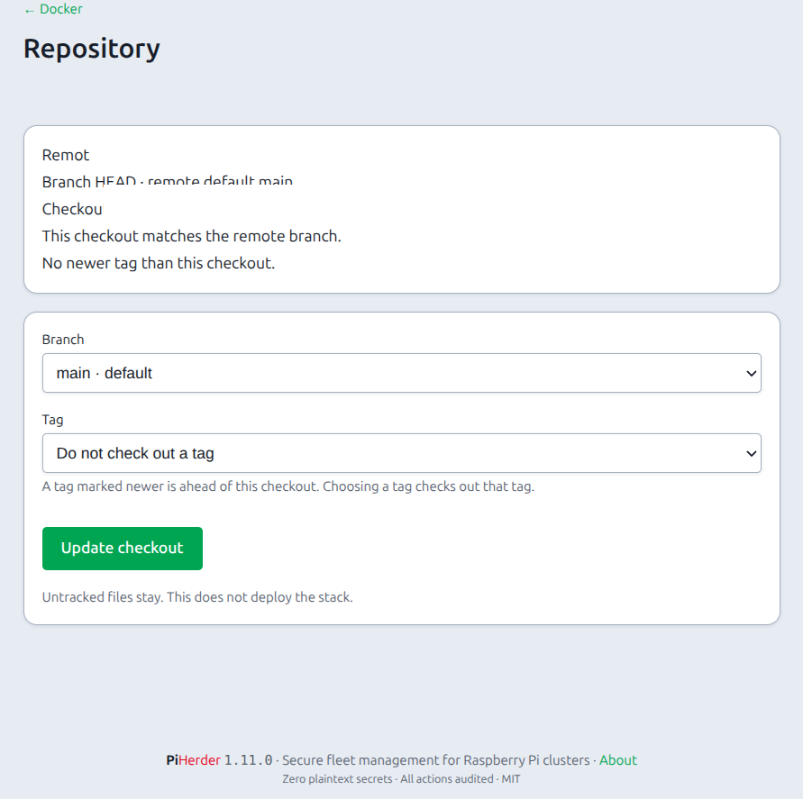
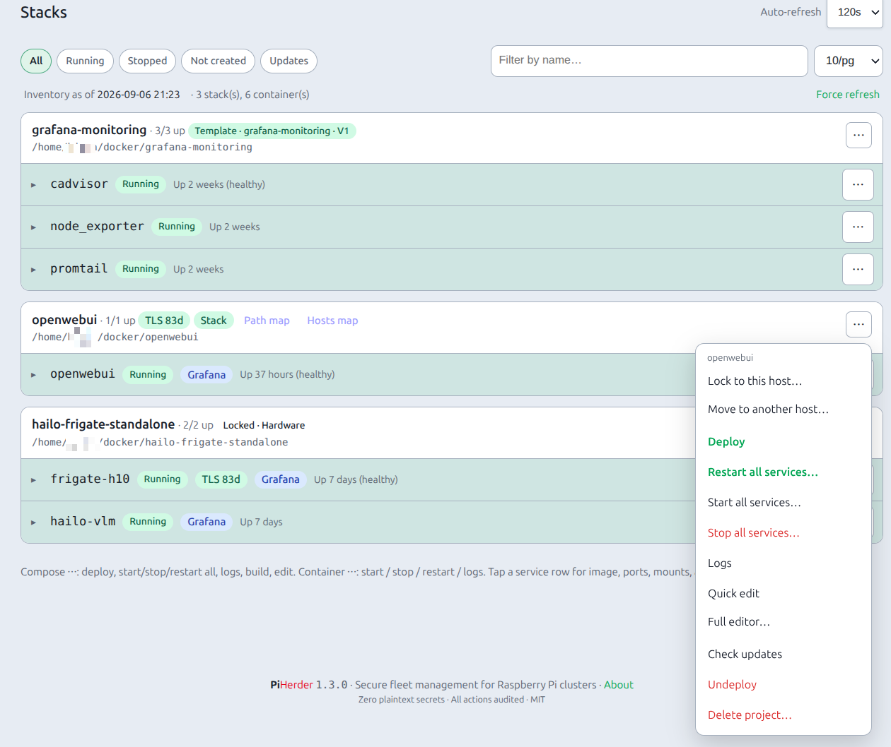

# Docker on hosts

## What this is

When **Docker / containers** is enabled for a server, PiHerder can list compose projects, stream logs, edit multi-file compose, build, check/update images, and redeploy — all over SSH as the server’s configured user.

## Why it exists

Homelab hosts often run many stacks. SSHing into each machine for `docker compose ps` does not scale, and ad-hoc edits leave no version history. The Docker UI is the day-to-day surface for free-form stacks; [templates](../service-templates/overview.md) cover desired-state managed stacks.

<figure class="ph-figure" markdown>
  
  <figcaption>Docker dest card on server detail.</figcaption>
</figure>

---

## End-to-end: open a stack and redeploy

1. Enable **Docker / containers**; set **Docker base dir** correctly.  
2. Confirm the dependency check for docker is green ([SSH access](../day-to-day/add-server.md)). On Ubuntu, Debian, or Raspbian, **Bootstrap missing tools** can install official Docker CE when this feature is already on ([Add a server](../day-to-day/add-server.md#bootstrap-missing-tools)).  
3. Open **Docker** — inventory snapshot appears immediately ([Inventory](inventory.md)).  
4. Expand a project; open logs if needed.  
5. **Check updates** vs **Deploy** when you want pull-only vs pull+up ([Updates](../day-to-day/updates-and-patching.md)).  
6. For compose edits, use [Compose edit](compose-edit.md) (quick modal or full editor with history).  
7. For a sidecar / log sitting next to the stack, or to copy a file out of a container, use [Host Files](../day-to-day/host-files.md) (jailed SFTP; flag `PIHERDER_HOST_FILES`).  
8. Hardware-bound stacks: **⋯ → Lock to this host**. Optional **Move to another host…** — [Move a service](service-migration.md).  

---

## Prerequisites

1. Feature flag **Docker / containers** on. Off leaves the Docker page on **off** and does not SSH.  
2. Remote `docker` usable by the SSH user (group/socket).  
3. **Docker base dir** set correctly (absolute path if using least-priv).  
4. Dependency check green for docker. If `docker-ce`, the Compose plugin, or docker group membership is missing, use **Bootstrap missing tools** ([Add a server](../day-to-day/add-server.md#bootstrap-missing-tools)). Other failures: [SSH troubleshooting](../troubleshooting/ssh-rsync.md). The same v1.13 train also covers restore ownership ([Backups](../day-to-day/backups.md)), a possible NIC change ([LAN Discovery](../integrations/lan-discovery.md)), and the stuck-queue warning ([Alerts](../operations/alerts-email-webhooks.md)). None of that is in the 1.12.1 image.

## What you can do

| Action | Notes |
|--------|--------|
| Browse projects / containers | From inventory snapshot ([Inventory](inventory.md)); **search + status chips + pager** are server-side (see below); containers as **dense rows** |
| Runtime stack / Path map | Project **Stack** / **Path map** pills → Network stack panel + map expand ([Network maps](../integrations/dns-fabric.md#runtime-stack-detail-altitude)) |
| Logs | Per container / service (modal or full page). Multi-service projects: pick a service **or All services** (project-level `docker compose logs`). Live SSE requires a **signed-in** session |
| **Stop / Start / Restart all** | Project ⋯ menu → confirm → **Job** with live log (`docker_stack_stop` / `_start` / `_restart`) — **operator+** |
| **Lock to this host** | Project ⋯ — [Move a service](service-migration.md). Hardware / operator / infra. HAOS always locked. Operator+. |
| **Move to another host…** | Flag `PIHERDER_SERVICE_MIGRATE` (default **on**; set **false** to hide). Preflight then **Celery** Job: stop → copy → dest up → DNS/NPM. Recycle **web** is safe; recycle **celery-worker** fails a running Move. NPM proxy-host binding is enough (no fabric row required). Optional leftover: leave stopped, `compose down`, or remove source + named volumes. A finished Move has no Undo. [Move a service](service-migration.md). |
| Container start / stop / restart | Row ⋯ on a single service (immediate; not a full-stack job) — **operator+**; actions allowlisted (`start`/`stop`/`restart`) |
| Quick edit / Full editor | ⋯ menu — quick modal is compose (± Dockerfile) only; **`.env` and sidecars** are full editor — [Compose edit](compose-edit.md) |
| Multi-file compose edit | primary compose + override + `.env` + Dockerfile + **compose sets** |
| **Compose sets** | Extra `docker-compose.<name>.yml` in the **same** project folder — see below |
| Version history | Snapshots; rollback |
| Build / redeploy | **POST-only** SSE stream of `docker compose build` for a **named** project (**operator+**). Paths are quoted; there is no GET `/path` fallback. Redeploy as Jobs. If a stopped container from the same project still holds the name, that container is removed and the deploy retries once. A container from another project, or one that is running, is left in place |
| Check updates vs Deploy | Pull-only vs pull+up as **Jobs** — [Updates](../day-to-day/updates-and-patching.md) |
| Cleanup unused | List dangling images and exited containers. Prune images, exited containers, or unused networks as a job. Unused volumes stay until the confirm on this page is ticked. The token API and hosted `/mcp` can start the same job with the `edit` scope, and they cannot prune volumes. A saved `docker_prune_schedule` on this page (empty means off) starts that same job (`both`: dangling images and exited containers) when container patch is on. Volumes stay off that schedule. About **View schedule** lists it, and a missed slot opens `docker_prune_missed`. Build cache and buildx cache are a separate button (`docker builder prune -f`, then `docker buildx prune -f`), `POST /api/v1/servers/{id}/docker/build-cache`, and hosted `prune_build_cache` (`edit`, one audit row `docker_build_cache_prune`, no schedule). A successful container update or redeploy then runs `docker image prune -f` (dangling images only). A prune failure does not fail that job. These follow-ups are on the v1.13 train and are not in the 1.12.1 image |
| New project wizard | Create a stack on the host |
| **Repository…** | Project ⋯ menu. Attach a git remote to a project that is already on the host, pick a branch or a tag, and update the checkout. A tag ahead of the checkout is marked newer. A tracked local edit stops the update until you keep those files or take the remote copies. Untracked files stay. This does not deploy. A folder or checkout the SSH user does not own is refused. An https URL with a user or token in it is refused. Use a deploy key or a credential helper |
| Template-managed stacks | Badge + gated full editor — [Templates](../service-templates/overview.md) |

<figure class="ph-figure" markdown>
  
  <figcaption>Prune dangling images, exited containers, or unused networks. The volume confirm is visible and not ticked. Image names are masked.</figcaption>
</figure>

A Docker inventory left at `refreshing` for 30 minutes, measured from `docker_inventory_at`, resets to stale when a snapshot exists and to never when it does not. A missing timestamp is not treated as expired. `GET /api/v1/inventory` and `GET /api/v1/servers/{id}/inventory` set `update_available` on each container, each image, and each compose project. Callers do not read `container_update_check` job logs for that flag. Both are on the v1.13 train and are not in the 1.12.1 image. The build-cache and scheduled-prune frame is reserved as `docker-build-cache-prune.png` and is not captured yet.

<figure class="ph-figure" markdown>
  
  <figcaption>v1.11. Repository on a project that is already a checkout. The remote default branch is selected. This frame has no newer tag. The project path and the remote URL are masked. Update checkout does not deploy.</figcaption>
</figure>

!!! note "Browser Back on Docker"
    Leaving Docker for another tool (template deployment, full editor) and pressing **Back** must not leave a stuck “Collecting information from host via SSH” overlay. The page clears the wait chrome when the stack is already loaded (bfcache-safe).

### Compose sets (same folder, one project card) {#compose-sets-same-folder-one-project-card}

One **directory** under the Docker base dir is still **one** project in the Docker list. You may keep more than one compose file there:

| File | Role |
|------|------|
| `docker-compose.yml` / `compose.yml` | **Primary** (main set) |
| `docker-compose.override.yml` | Compose auto-merge — multi-file editor, not a separate set |
| `docker-compose.<name>.yml` | **Compose set** (e.g. `docker-compose.e2e.yml` → set **e2e**) |

**UI:** under the project header, pills **All · main · e2e · …** filter which services are listed **inside a visible project**. This is **not** a second stack card and stays **client-side**.

### Filter and page stacks {#docker-list-filter}

Status chips (All / Running / Stopped / Not created / Updates) and the name box are **GET query params** (`q`, `status`, `page`, `per_page`). A project stays if its name **or** any service/image matches the search (same aliases as Servers — `ha` → Home Assistant). Page size is the shared **10 / 20 / 50 / 100** cookie. Hero totals stay the unfiltered inventory.

HTMX refresh keeps the query so filters do not reset. `?project=foo` after Deploy still jumps to that stack. Compose-set pills are unchanged.

**Deploy:** project ⋯ → **Deploy** runs the whole project (default Compose resolution). **Deploy \<set\> set** runs `docker compose -f <that-file> up -d` still under the **same** project name / directory.

**vs fabric view groups:** compose sets are **files on disk / deploy slices**. Network **view groups** (Main / custom) are **presentation only** on the stack panel and map — [Network maps](../integrations/dns-fabric.md#visual-service-stacks--view-groups).

### Project lifecycle (stop, start, restart all) {#project-lifecycle-stop--start--restart-all}

From a compose project **⋯** menu:

1. Choose **Stop all services…**, **Start all services…**, or **Restart all services…**  
2. Confirm — host + project name; **Stop** uses danger styling.  
3. A **Job** runs `docker compose stop|start|restart` over SSH with a live log (same JobHold pattern as Deploy).  
4. Success refreshes inventory; **Jobs** / **Audit** record `docker_stack_stop` / `_start` / `_restart`.  

Only **one** stack mutation runs at a time per host (shared lane with Deploy and template deploy/redeploy). Operator+ only. Single-container start/stop/restart stay on the **service row** ⋯ menu. Home Assistant plugin **0.5.2** can start, stop, restart, or update that same one service, and can **Stop project** (`docker compose stop`, not down or remove) after a confirm. It can also start a stop-first Move. Files on that card stay in the fleet jail.

<figure class="ph-figure" markdown>
  
  <figcaption>Project ⋯ **Lock to this host…** / **Move to another host…** plus Stop / Start / Restart all.</figcaption>
</figure>

## Template vs free-form stacks

| Kind | Edit path | Why |
|------|-----------|-----|
| **Template-managed** | Desired state / redeploy / **Accept host as desired** on deployment page; host file editor gated | Template desired state is source of truth |
| **Free-form** | Full compose multi-file editor (compose, `.env`, sidecars, sets) | Bring-your-own stacks |

## Related

- [Inventory cache](inventory.md)  
- [Compose edit & deploy](compose-edit.md)  
- [Move a service](service-migration.md) — lock, preflight, copy, dest up, DNS/NPM, rebind, leftover  
- [Service templates](../service-templates/overview.md)  
- [Reports](../day-to-day/reports.md) — deploy / patch job history (running-now is last inventory only)  
